<div align="center">

# 📡 PageRadar

**真正会定时运行的网页变更雷达 —— 关掉浏览器，它还在盯着。**

在服务端按你设定的频率抓取公开网页、保存快照、计算差异，变化时用 Webhook 通知你。

<a href="https://x.com/0xkillcoin"></a>


[**在线体验**](https://pageradar.852367856.dpdns.org/) · [架构](#-架构) · [安全模型](#-安全模型) · [数据库结构](#-数据库结构) · [部署指南](#-部署指南)

</div>

---

## 📸 截图

全部由 `scripts/shoot.mjs` 从**线上部署**自动抓取，不是示意图。

| 落地页 | 创建工作区（令牌只显示一次） |
| :---: | :---: |
| 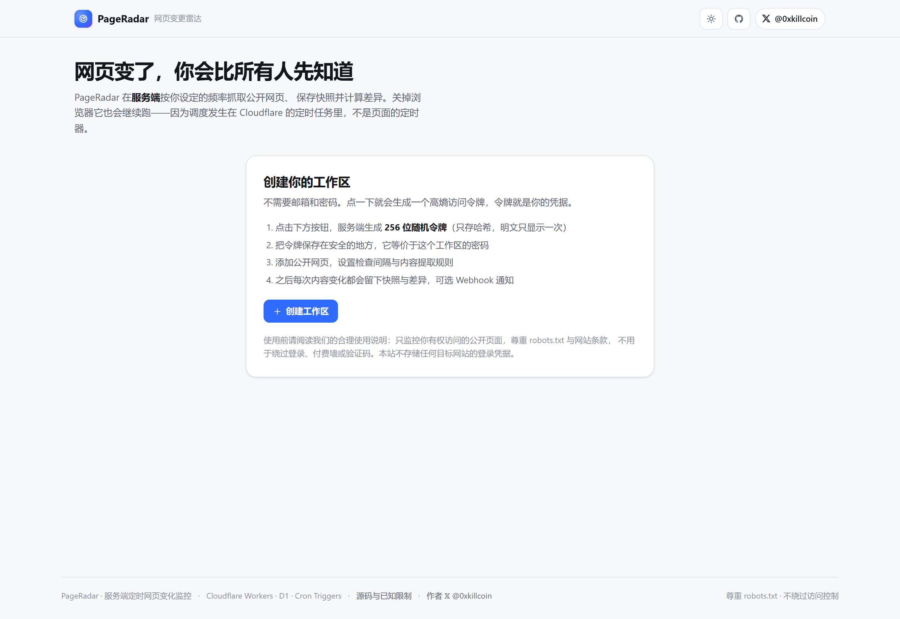 | 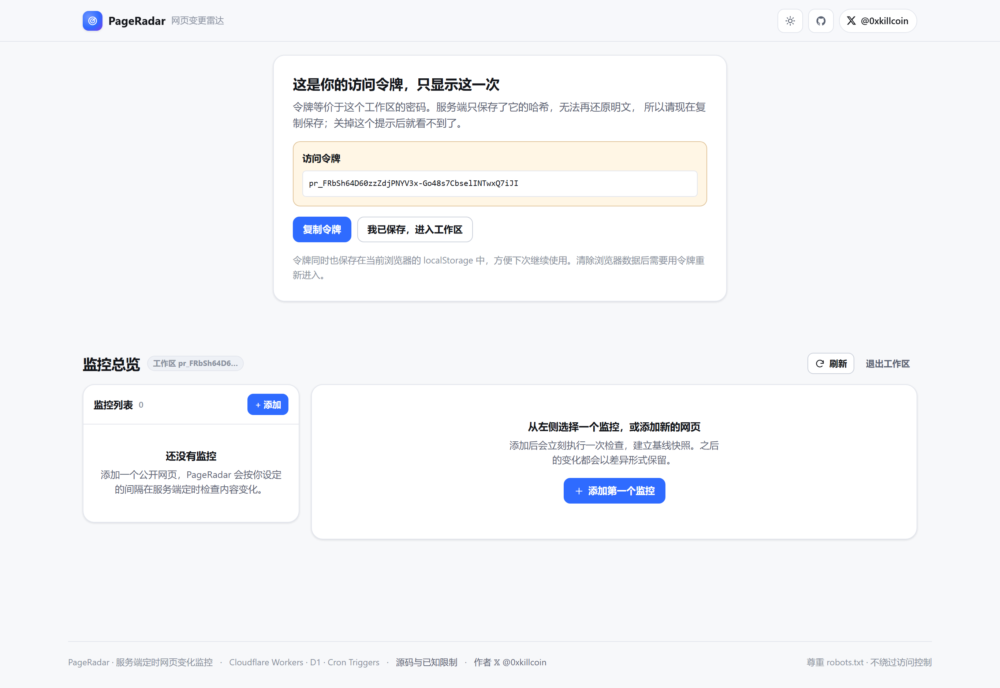 |

| 监控列表 + 状态总览 |
| :---: |
| 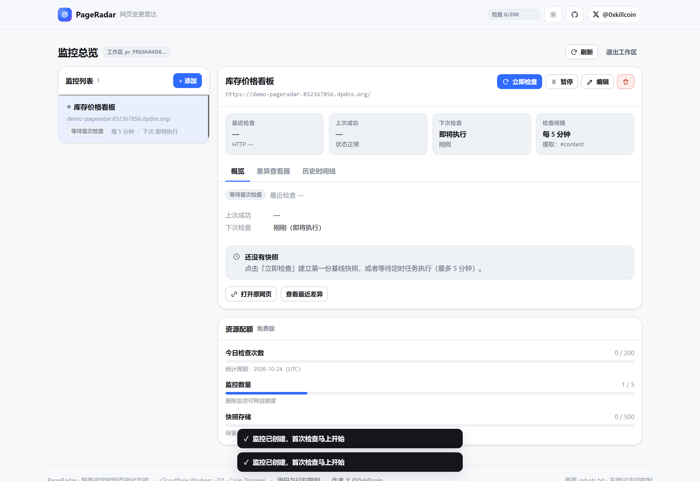 |

| 差异查看器（新增 / 删除分色标记） | 纯文本模式 |
| :---: | :---: |
| 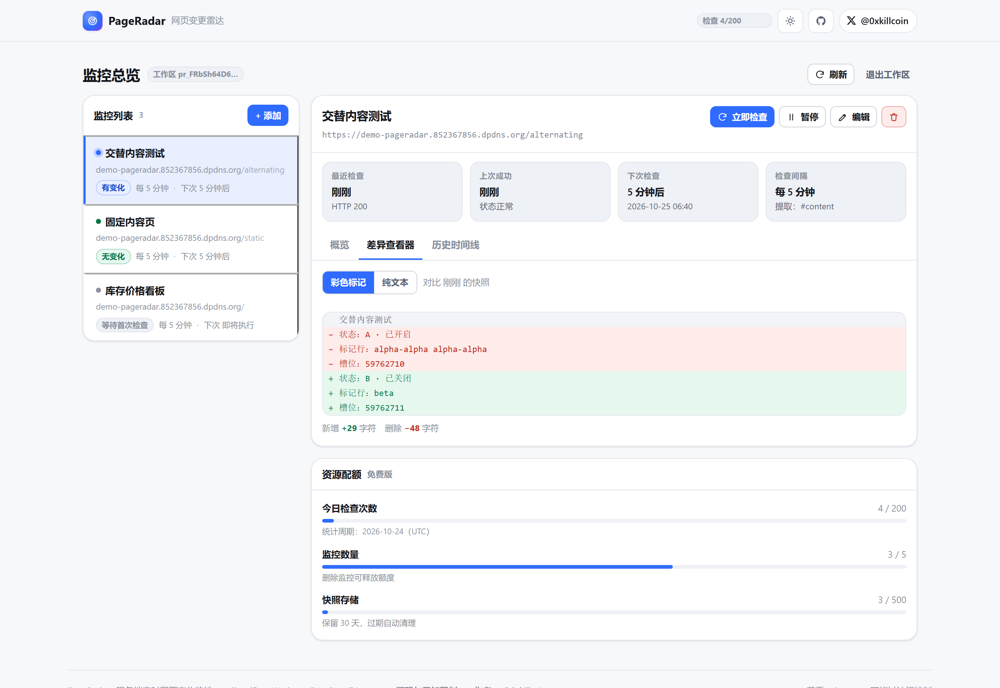 | 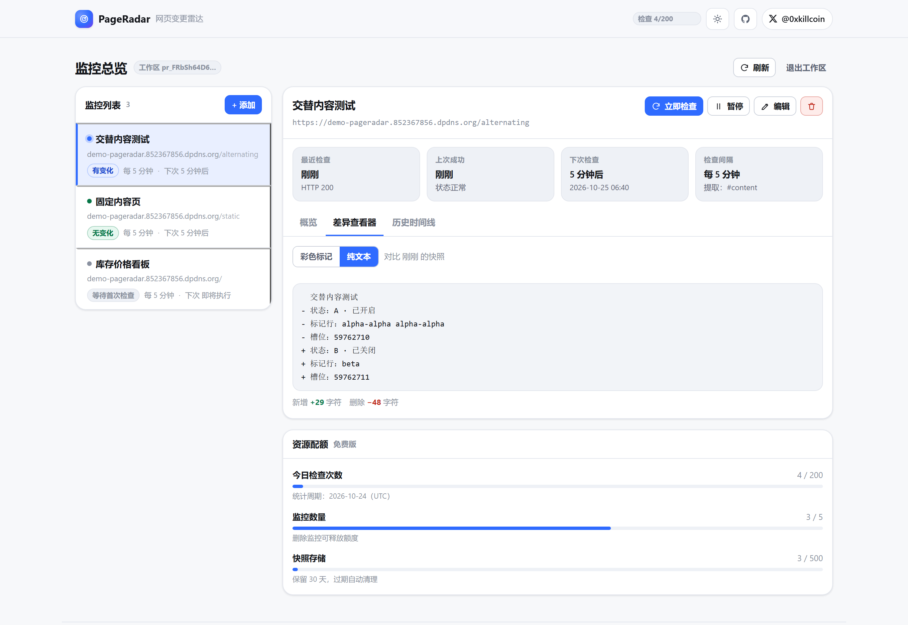 |

| 历史时间线 | 深色模式 |
| :---: | :---: |
| 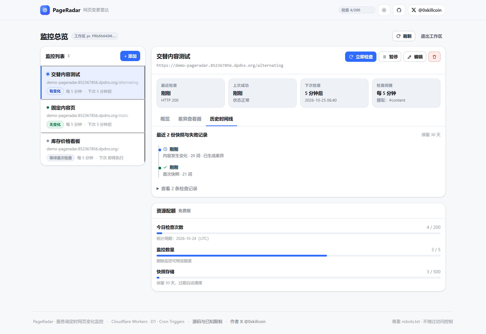 | 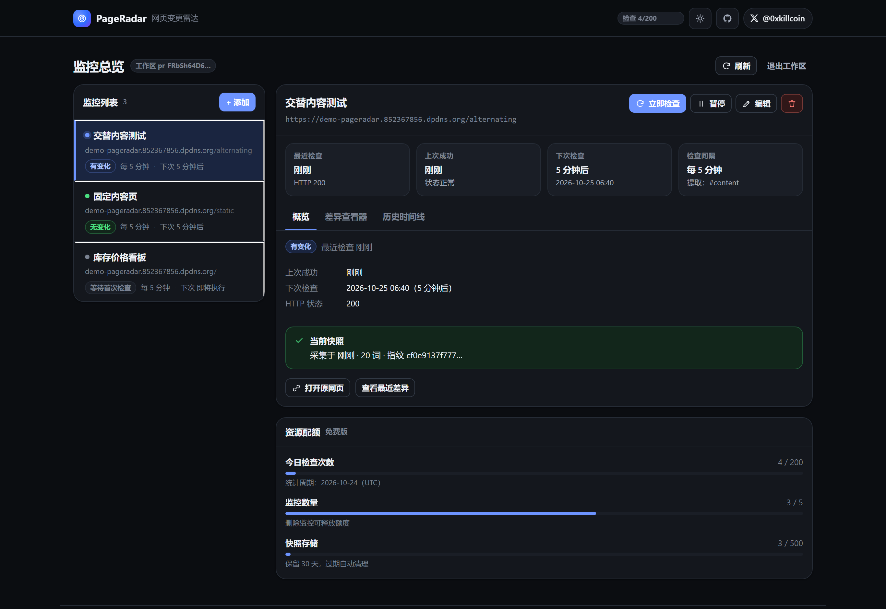 |

| 添加监控（含提取规则说明） | iPhone 尺寸 |
| :---: | :---: |
| 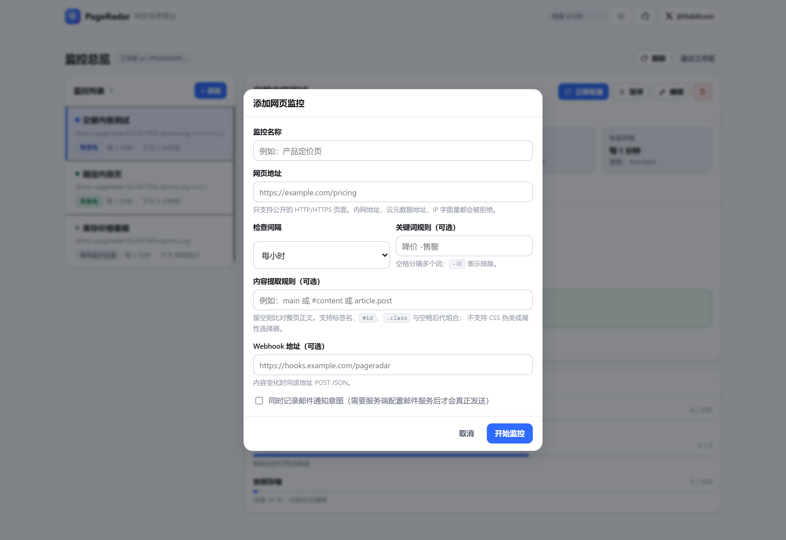 | 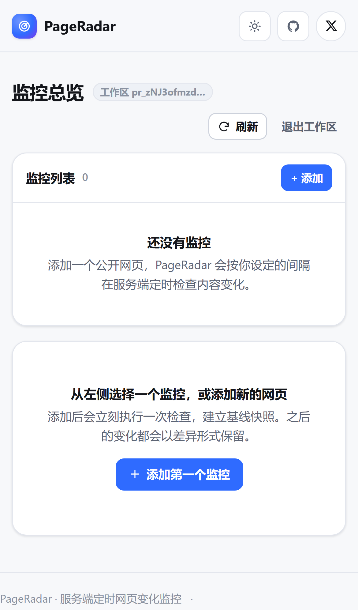 |

---

## 💡 它解决什么问题

你要盯的东西太多了：

- 🏷️ 竞品的**定价页**什么时候悄悄改价
- 📄 政策 / 条款 / 公告页面什么时候更新了一句话
- 🎟️ 演出 / 球票 / 限量商品的**库存状态**什么时候从「售罄」变成「有货」
- 📊 你关注的榜单、招聘 JD、开源项目的 README 什么时候变了
- 🐛 某个服务的状态页什么时候发布了新的故障说明

手动刷新是不可能的。浏览器插件关掉标签页就停了。

**PageRadar 把调度放在服务端**：Cloudflare Cron Triggers 每 5 分钟唤醒一次 Worker，检查所有到期任务。你的电脑可以关机，监控照常进行。

---

## ✨ 功能清单

| | 功能 | 说明 |
| :---: | :--- | :--- |
| ✅ | **安全工作区** | 无需邮箱密码，256 位随机令牌，服务端只存 SHA-256 哈希 |
| ✅ | **添加 / 编辑 / 删除监控** | 名称、URL、间隔（5 分钟 ~ 1 天）、提取规则、关键词规则 |
| ✅ | **真正的服务端定时** | Cloudflare Cron Triggers `*/5 * * * *`，关闭浏览器照常运行 |
| ✅ | **手动立即检查** | 随时触发一次，不等到下个周期 |
| ✅ | **暂停 / 恢复** | 暂停后不再抓取，历史快照与差异保留 |
| ✅ | **快照存储** | 只存正文文本与指纹；内容未变时不写新快照（幂等） |
| ✅ | **差异计算** | 按行 LCS，输出 add / del / equal 操作序列与字符计数 |
| ✅ | **差异可视化** | 新增绿色、删除红色、行首标记；支持纯文本模式 |
| ✅ | **历史时间线** | 每次快照、失败、配额超限都有记录与原因 |
| ✅ | **状态总览** | 最近检查、上次成功、下次计划、HTTP 状态、连续失败次数 |
| ✅ | **关键词规则** | 空格分隔多词，`-词` 表示排除 |
| ✅ | **内容提取规则** | 标签名 / `#id` / `.class` / 后代组合；留空比对整页 |
| ✅ | **Webhook 通知** | 内容变化时 POST JSON；失败不阻塞主流程；界面脱敏显示 |
| ✅ | **配额与保留期** | 每日检查次数、监控数量、快照存储、历史保留天数 |
| ✅ | **失败退避** | 连续失败时指数退避（最长 6 小时），避免无谓地打对方服务器 |
| ✅ | **深色模式** | 跟随系统 + 手动三态切换 |
| ✅ | **移动端自适应** | 375px 起可用，触控目标 ≥ 33px |
| ✅ | **键盘可操作** | 全流程 Tab 可达，Esc 关闭弹窗 |

---

## 🏗 架构

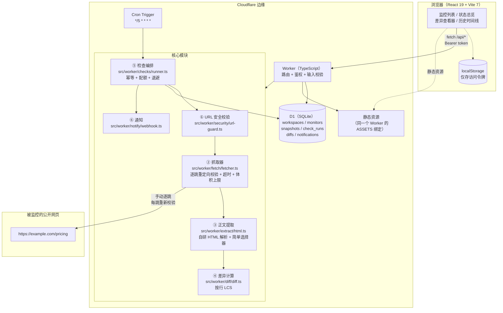

### 目录结构

```
src/
├── shared/types.ts              前后端共享类型
├── worker/
│   ├── index.ts                 路由 + 鉴权 + 校验 + Cron 入口
│   ├── auth/auth.ts             令牌生成 / SHA-256 / Bearer 提取 / 速率限制
│   ├── security/url-guard.ts    ★ SSRF 防护（协议/端口/IP/域名/DNS 分类）
│   ├── fetch/fetcher.ts         ★ 逐跳校验的抓取器 + robots.txt
│   ├── extract/html.ts          ★ HTML 解析 + 正文提取 + 选择器 + 关键词
│   ├── diff/diff.ts             ★ 按行 LCS 差异 + 内容指纹
│   ├── checks/runner.ts         ★ 检查编排（幂等/配额/退避/通知/清理）
│   ├── notify/webhook.ts        Webhook 发送 + 脱敏
│   └── db/queries.ts            所有 SQL（强制 workspace_id 过滤）
├── client/
│   ├── App.tsx                  状态编排 + 四个主要区域
│   ├── api.ts                   API 客户端
│   ├── components/              DiffView / Timeline / MonitorList / MonitorFormModal
│   ├── format.ts                时间与单位格式化
│   ├── icons.tsx                内联 SVG
│   └── styles.css               设计系统（含深色模式与响应式）
└── demo-worker/                 独立的演示/测试目标页（见下方说明）
migrations/0001_init.sql         数据库结构
scripts/verify-live.mjs          线上端到端验证（42 项）
scripts/shoot.mjs                README 截图生成
```

### 为什么演示页要单独部署

主 Worker 如果抓取自己域名下的路径，会形成 **Worker 子请求递归**，Cloudflare 直接返回 522。所以 `demo-worker/` 是一个独立的 Worker + 独立域名，提供：

| 端点 | 用途 |
| :--- | :--- |
| `/` | 正文随 5 分钟槽位变化 —— 验证真实变化检测 |
| `/alternating` | 每 30 秒翻转 —— 几十秒内验证「变化 → 快照 → 差异」 |
| `/static` | 永不变 —— 验证 nochange 与幂等 |
| `/redirect/2` | 两跳 302 —— 验证正常重定向跟随 |
| `/to-metadata` | 302 → `169.254.169.254` —— 验证 SSRF 能拦住恶意重定向 |
| `/slow?ms=15000` | 慢响应 —— 验证超时 |
| `/json` | JSON 响应 —— 验证 content-type 拒绝 |
| `/403` `/404` | 验证错误分类 |

---

## 🔐 安全模型

### SSRF 防护（这是本项目最核心的安全工作）

攻击者能用「添加监控」这个功能做很多坏事。下面每一条都有对应的代码与测试：

| 攻击向量 | 防护方式 | 代码位置 |
| :--- | :--- | :--- |
| `http://127.0.0.1/` | IPv4 回环段判定 | `classifyIpv4` |
| `http://10.x` `172.16-31.x` `192.168.x` | 私网段判定 | `classifyIpv4` |
| `http://169.254.169.254/latest/meta-data/` | 链路本地段判定（云元数据） | `classifyIpv4` |
| `http://[::1]/` `fd00::` `fe80::` | IPv6 回环 / ULA / 链路本地 | `classifyIpv6` |
| `http://2130706433/` `0x7f000001` `0177.0.0.1` | 十进制/十六进制/八进制归一化后再判定 | `normalizeNumericHost` |
| `http://localhost/` `metadata.google.internal` `*.internal` `*.local` `*.svc` | 主机名黑名单 + 内部 TLD 黑名单 | `BLOCKED_HOSTNAMES` / `BLOCKED_TLDS` |
| **DNS rebinding**（首次解析是公网，后续变内网） | **每次请求前都做 DNS 解析（DoH），解析结果含私网地址即拒绝** | `resolveHost` + `checkResolvedAddresses` |
| **恶意重定向**（301 跳内网） | `redirect: 'manual'`，**每一跳都重新做 URL + DNS 校验** | `safeFetch` 循环 |
| `file://` `gopher://` `ftp://` | 协议白名单（只允许 http/https） | `checkUrl` |
| 非标准端口 `:22` `:6379` `:5432` | 端口白名单（80/443/8080/8443） | `checkUrl` |
| URL 内嵌凭据 `user:pass@` | 显式拒绝 | `checkUrl` |
| 超长 URL / 超长请求体 | 长度上限 | `checkUrl` / `safeJson` |

**资源限制**：

- 单次抓取总超时 20 秒，单跳 10 秒
- 响应体上限 2 MB，**边读边计数，超限立刻中止**（不是读完再判断）
- 最多 5 跳重定向，检测到循环直接中止
- 只接受 `text/html` / `application/xhtml+xml` / `text/plain` 等文本类型
- HTML 解析：节点上限 20 万、深度上限 128、文本上限 200 万字符
- 差异计算：DP 表上限 2000×2000，超过则退化为锚点对齐（不会爆内存）

### 认证与授权

```
1. POST /api/workspace
   → 生成 32 字节（256 位）随机令牌，base64url 编码，前缀 pr_
   → 数据库只存 SHA-256 哈希 + 前 12 字符前缀（用于界面展示）
   → 明文令牌只在这一次响应中返回

2. 之后每个请求带 Authorization: Bearer pr_xxx
   → 服务端 sha256(token) 查库
   → 拿到 workspace，所有查询强制 WHERE workspace_id = ?
```

**为什么用 SHA-256 而不是 bcrypt/argon2**：慢哈希是为了抵抗**低熵口令**的暴力破解。这里是 256 位密码学随机值，搜索空间是 2²⁵⁶，慢哈希只是白白增加每次请求的开销。这是有意的设计选择，不是偷懒。

**跨工作区隔离**：所有按 id 访问的接口都同时校验 `workspace_id`。用别人的 monitor id 访问会返回 404（而不是 403，避免泄露「这个 id 存在」）。线上验证里的第 24 项就是在测这个。

### robots.txt 与合理使用

- 每次抓取前获取并解析 `robots.txt`（按 host 缓存 1 小时）
- 被 `Disallow` 的路径直接跳过，**不会尝试绕过**
- 支持 `Crawl-delay`（间隔会按较长值安排）
- **不绕过登录、付费墙、验证码、Cloudflare 挑战页**
- 明确的 User-Agent：`PageRadarBot/1.0 (+repo; change detection; respects robots.txt)`

### 密钥与凭据

| 内容 | 存储方式 | 界面展示 |
| :--- | :--- | :--- |
| 访问令牌 | D1 中只存 SHA-256 哈希 | 只在创建时显示一次，之后不再返回 |
| Webhook URL | D1 明文（服务端要用它发请求） | 列表与详情返回**脱敏值**（`https://host/xxx…`） |
| Cloudflare API Token | 仅存在于本地环境变量，**不写入仓库** | 不涉及 |
| 邮件服务密钥 | 环境变量 `EMAIL_API_KEY`（可选，未配置则不发） | 不涉及 |

### 速率与配额

| 限制 | 值 | 实现 |
| :--- | :--- | :--- |
| 每 IP 每分钟 API 请求 | 120 | 内存限流器 |
| 每 IP 每分钟创建工作区 | 10 | 内存限流器 |
| 每工作区每日检查次数 | 200 | D1 `check_counter` 表 |
| 每工作区监控数量 | 5 | 创建时计数校验 |
| 每工作区快照数量 | 500 | 创建快照前校验 |
| 历史保留 | 30 天（按工作区） | 检查后按 `created_at` 清理 |
| Cron 单批处理 | 8 个任务 | `dueMonitors` LIMIT |
| Cron 并发保护 | 55 秒租约 | `cron_leases` 表 |

---

## 🗄 数据库结构

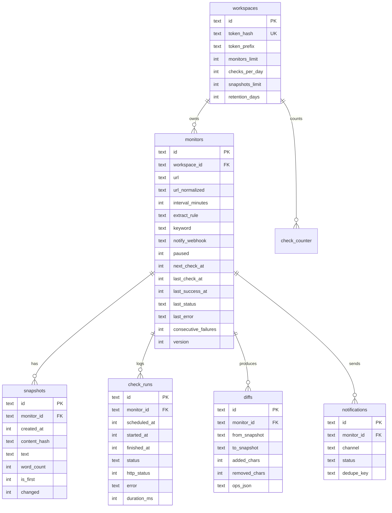

完整定义见 [`migrations/0001_init.sql`](migrations/0001_init.sql)。

### 幂等设计（防重复快照与重复通知）

这是定时任务最容易写错的地方，所以单独说明：

1. **`check_runs` 的唯一索引 `(monitor_id, scheduled_at)`**
   同一调度槽位只可能插入一条记录。第二个并发实例插入失败 → 直接跳过，不会重复抓取。
2. **内容指纹比对**
   抓到的正文算出 FNV-1a 指纹，与上一次快照相同 → 不写新快照，只更新 `last_check_at`。
3. **`notifications` 的唯一索引 `(monitor_id, dedupe_key, channel)`**
   同一次变化（dedupe_key = `diff:<diffId>`）对同一渠道只发一次。
4. **`monitors.version` 乐观锁**
   定时任务与手动检查并发时，只有一个能写入结果。
5. **`cron_leases` 表**
   两个 cron 实例同时唤醒时，只有一个能拿到租约，另一个直接返回。

线上验证的第 13 项专门测「重复检查不新增快照」：`1 → 1`。

---

## 🚀 在线体验

👉 **<https://pageradar.852367856.dpdns.org/>**

> 部署在 Cloudflare Workers（免费额度内），前端与 API 同域同 Worker，没有跨域。
>
> ⚠️ **`pageradar.changyuansex.workers.dev` 这个默认地址在国内网络环境下可能被干扰（TCP 连接超时）。** 上面这个自定义域名绑定在同一个 Worker 上，可以正常访问。这是网络环境问题，不是服务问题。

**演示页**（可用来测真实变化检测）：<https://demo-pageradar.852367856.dpdns.org/>

---

## 💻 本地开发

```bash
# 1. 克隆
git clone https://github.com/iiiiiiiiiiiiiKK/pageradar.git
cd pageradar

# 2. 安装
pnpm install

# 3. 创建本地 D1 并应用迁移
pnpm exec wrangler d1 migrations apply pageradar-db --local

# 4. 启动（前端 HMR + Worker 本地运行时）
pnpm exec wrangler dev

# 打开 http://localhost:8787
```

> `wrangler dev` 会同时提供 Worker API 与 `dist/` 静态资源。前端开发时如果要用 Vite 的 HMR，可以另开一个终端跑 `pnpm dev`，并在 `vite.config.ts` 里把 `/api` 代理到 `http://127.0.0.1:8787`。

### 环境变量 / 绑定

| 名称 | 类型 | 必填 | 说明 |
| :--- | :--- | :---: | :--- |
| `DB` | D1 数据库绑定 | ✅ | 主数据库 |
| `ASSETS` | 静态资源绑定 | ✅ | 前端构建产物 |
| `ENVIRONMENT` | 文本变量 | ➖ | 默认 `production` |
| `USER_AGENT` | 文本变量 | ➖ | 覆盖默认 UA |
| `EMAIL_API_KEY` | Secret | ➖ | 邮件服务密钥；**未配置时邮件通知会明确记录「未配置」而不是假装成功** |

设置 Secret：

```bash
pnpm exec wrangler secret put EMAIL_API_KEY
```

**仓库中不包含任何真实密钥。** `wrangler.toml` 里的 `database_id` 是资源标识（非密钥），必须填自己的。

---

## 🧪 测试

### 单元测试（73 个）

```bash
pnpm test
```

实际输出：

```
 ✓ tests/unit/diff.test.ts      (14 tests)
 ✓ tests/unit/html.test.ts      (19 tests)
 ✓ tests/unit/robots.test.ts    (6 tests)
 ✓ tests/unit/runner.test.ts    (17 tests)
 ✓ tests/unit/url-guard.test.ts (17 tests)

 Test Files  5 passed (5)
      Tests  73 passed (73)
```

| 测试文件 | 覆盖内容 |
| :--- | :--- |
| `url-guard.test.ts` | 17 个用例：私网/回环/元数据/IPv6/十进制编码/内部域名/协议/端口/凭据/DNS 结果校验 |
| `html.test.ts` | 19 个用例：解析、实体、空元素回归、选择器、关键词、资源限制 |
| `diff.test.ts` | 14 个用例：增删改、中间插入对齐、大文件退化、指纹 |
| `robots.test.ts` | 6 个用例：UA 分组、Allow 优先、通配符、不可用降级 |
| `runner.test.ts` | 17 个用例：调度槽位对齐、Webhook 脱敏、词数统计、令牌生成与哈希 |

### 线上端到端验证（42 项）

```bash
node scripts/verify-live.mjs
```

**实际执行结果：`42/42 passed`**

```
✔ 健康检查返回 ok 且数据库已连接
✔ 前端页面可访问且含应用挂载点
✔ 未携带令牌访问被拒绝 (401)
✔ 伪造令牌被拒绝 (401)
✔ 可以创建工作区并获得令牌
✔ 有效令牌可以列出（空）监控列表
✔ 配额信息一并返回
✔ 10 种 SSRF 攻击向量全部被拒绝
✔ 非法检查间隔被拒绝 (422)
✔ 缺少名称被拒绝 (422)
✔ 可以添加公开页面监控
✔ 同一工作区重复添加同一 URL 被拒绝 (409)
✔ 首次手动检查建立基线快照
✔ 内容未变时返回 nochange
✔ 历史快照可读取
✔ 详情包含配额、运行记录与时间线数据
✔ 快照内容包含页面正文
✔ 无变化时重复检查不新增快照（幂等）— 1 → 1
✔ 页面内容真实变化时生成快照与差异 — first=first second=changed diff=+29/-48
✔ 差异操作序列包含 add 与 del — ops=3
✔ 历史里有 2 份快照
✔ 404 页面返回可理解的错误 — 服务器返回 HTTP 404（页面不存在）
✔ 403 页面返回可理解的错误 — 服务器返回 HTTP 403
✔ 慢响应触发超时保护并给出可理解错误 — 11008ms
✔ 正常的 2 跳重定向能被正确跟随
✔ 重定向到云元数据地址被拦截（逐跳校验）
✔ 非 HTML 内容被拒绝并说明原因
✔ 空正文给出可理解提示
✔ 监控状态包含最近检查与下次检查时间
✔ 可以暂停监控
✔ 可以恢复监控
✔ 可以编辑名称与间隔
✔ Webhook 配置被接受且检查本身正常完成
✔ Webhook 地址在响应中已脱敏 — https://httpstat.us/500…
✔ 其他工作区无法读取本工作区的监控 (404)
✔ 其他工作区无法删除本工作区的监控 (404)
✔ 其他工作区的列表不包含本工作区数据
✔ 超长名称被拒绝 (422)
✔ 非法 JSON 被拒绝 (422)
✔ 非法选择器不会导致 500（错误被结构化）
✔ 可以删除监控
✔ 删除后无法再读取
```

### 定时任务真实验证

Cron 监控一个每 5 分钟变化的自托管页面，在**没有任何手动触发**的情况下观察：

```bash
node tmp-probe/cron-check.mjs   # 见 README 说明，等价于调用 GET /api/monitors/:id
```

| 时间（UTC） | 触发方式 | 状态 |
| :--- | :--- | :--- |
| 22:35:50 | 手动 | `first`（建立基线） |
| 22:40:50 | **Cron** | `nochange` / `changed`（取决于槽位） |
| 22:45:50 | **Cron** | 同上 |

> 真实观测结果见文末「已知限制与验证记录」一节。

---

## 📦 部署指南

### 前置

- Cloudflare 账号（免费版即可）
- Node.js 20+、pnpm
- `CLOUDFLARE_API_TOKEN`（需要 `Workers Scripts:Edit`、`D1:Edit` 权限）

### 步骤

```bash
# 1. 安装
pnpm install

# 2. 创建 D1 数据库
pnpm exec wrangler d1 create pageradar-db
# 输出中的 database_id 填进 wrangler.toml

# 3. 应用迁移
pnpm exec wrangler d1 migrations apply pageradar-db --remote

# 4. 构建前端
pnpm build

# 5. 部署 Worker（同时上传静态资源、注册 Cron Trigger）
pnpm exec wrangler deploy
```

部署完成后会得到 `https://pageradar.<your-subdomain>.workers.dev`。

### 绑定自定义域名（可选，推荐）

`workers.dev` 在国内网络可能不可达。绑定自有域名后走 Cloudflare 边缘，稳定性好很多：

```bash
curl -X PUT "https://api.cloudflare.com/client/v4/accounts/$ACCOUNT_ID/workers/domains" \
  -H "Authorization: Bearer $CLOUDFLARE_API_TOKEN" \
  -H "Content-Type: application/json" \
  -d '{
    "zone_id": "<你的 zone id>",
    "hostname": "pageradar.example.com",
    "service": "pageradar",
    "environment": "production"
  }'
```

> 不要手动去加 DNS 记录 —— Workers 自定义域名接口会自动创建所需的记录与证书。

### 演示页（可选）

```bash
pnpm exec wrangler deploy --config demo-worker/wrangler.toml
```

再按上面的方式给它绑定一个独立域名即可。

### 验证部署

```bash
node scripts/verify-live.mjs https://your-domain.example.com https://demo.your-domain.example.com
```

---

## ⚠️ 已知限制

诚实地说清楚做不到什么：

| 限制 | 说明 | 是否有计划 |
| :--- | :--- | :--- |
| **不执行 JavaScript** | Worker 里没有浏览器环境，纯前端渲染（CSR）的页面抓到的正文是空的。会明确报「正文为空（可能是纯 JS 渲染）」而不是假装成功。 | 需要接 Browser Rendering，会让成本上升，暂不做 |
| **不处理需要登录的内容** | 不保存目标站点的 Cookie / 凭据，不绕过登录、付费墙、验证码 | 不计划（这是产品原则，不是技术限制） |
| **不绕过反爬** | 被 Cloudflare 挑战页 / WAF 拦截时返回 403 或 5xx，如实报错 | 不计划 |
| **选择器能力有限** | 只支持标签名、`#id`、`.class`、空格后代组合。不支持 `>` `+` `~`、属性选择器、伪类 | 可以扩展，优先级低 |
| **差异按行** | 极度零碎的变化（如单字符改错）会在整行标记为删除+新增 | 可加行内字符级 diff |
| **邮件通知未接入** | 只记录意图，需要自行配置 `EMAIL_API_KEY` 与邮件服务 | 可选，看需求 |
| **单实例 Cron** | 每 5 分钟最多处理 8 个到期任务。监控数量很大时需要拆分批次或增加触发频率 | 可扩展 |
| **不做内容渲染快照** | 只存文本，不存 HTML 或截图。想看当时的排版需要访问原页面 | 可存 HTML，但会显著增加存储 |
| **workers.dev 域名国内可能不可达** | 网络环境问题，绑定自定义域名即可 | 已提供方案 |
| **免费额度** | Workers 10 万请求/天、D1 500 万行读/天 / 10 万行写/天、Cron 免费 | 监控数量大时会触达 |

### 验证记录（真实观测）

见 [`docs/VERIFICATION.md`](docs/VERIFICATION.md)：包含 Cron 真实触发日志、线上 42 项验证的原始输出、以及过程中发现并修复的真实 bug。

---

## 📄 许可证

[MIT](LICENSE) © [0xkillcoin](https://x.com/0xkillcoin)

---

<div align="center">

**如果这个工具帮到了你，欢迎点个 ⭐**

<a href="https://x.com/0xkillcoin">𝕏 @0xkillcoin</a>

</div>
